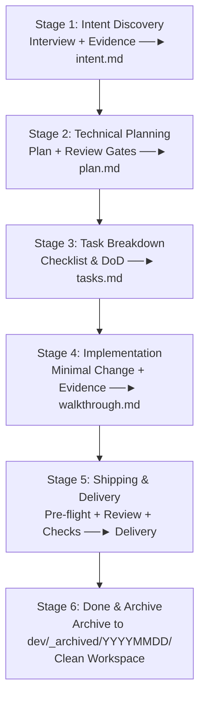

# Compass Master Engineer Skill (`comp-engineer`)

Use the current host's native skill invocation and exposed tools; bare `comp-*` names identify capabilities, not a fixed command syntax. Honor applicable host/repository instructions (including `AGENTS.md` or `CLAUDE.md`) and permissions; missing delegation never waives mandatory review.

This skill orchestrates the complete, end-to-end Spec-Driven Development (SDD) engineering lifecycle across technology stacks: from initial idea exploration to verified delivery and archiving.

---

## Decisions, Modes & Existing Work

- Match the requested action: a standalone analysis, review, or readiness assessment is read-only. Report findings without entering implementation/shipping, repairing artifacts, or logging to walkthrough unless those writes were requested. Mandatory logging applies when actually executing an authorized stage, not when assessing it.
- Follow higher-priority platform instructions and explicit user authorization. Within the project, user-agreed outcomes define intent; mandatory repository/constitution rules constrain the solution; plans/tasks implement that intent; code is evidence of current behavior, not permission to change requirements. Resolve harmless stale details from evidence. For material intent/rule conflicts, identify the conflict and ask the authorized owner; record any approved exception, scope, owner, and rationale. Never silently weaken security/data safeguards or mandatory gates.
- Choose **standard** for substantial or risky work, **light** for small bounded work, and **spike** for an explicitly exploratory task. Record the choice; the user can override document size, but required safety and verification still apply. Light artifacts may combine sections and omit empty phases. A spike keeps `intent.md` plus `walkthrough.md`, with its learning plan/checklist embedded in intent; production implementation uses a new or revised standard/light plan after the learning result is accepted.
- On rerun, read existing artifacts and evidence first. Preserve user edits, criterion/task IDs, completed work, decisions, and walkthrough history. Update only affected sections; append IDs for new work. Changed behavior reopens affected tasks with a reason and invalidates their checks/review. Removed work is marked `SUPERSEDED` with a reason, not silently deleted or counted DONE. Recompute progress from active tasks; do not reset it to zero.

---

## Project Adaptation

For a new agent host, read [Host Integration](references/hosts.md) to map discovery, invocation, tools and delegated roles without changing the lifecycle.

Before entering a stage, apply [stage capability preflight](references/hosts.md#stage-capability-preflight) against actual exposed tools, context controls and authorization. Repeat on a host/session change. Record the affected blocked gate while continuing useful independent authorized stages; installation or host version alone does not prove workflow readiness. Use [portable role packets](../comp-implement/references/packets.md) for dispatch and cross-host resume.

Keep the Compass lifecycle and artifact handoffs; adapt implementation to repository evidence.

- Use the user's instructions, repository guidance, existing code, manifests, and CI to establish architecture, relevant paths, verification commands, and delivery conventions. Do not infer a stack from these templates.
- Use `dev/{feature-slug}/` by default; honor an established or user-selected artifact root and carry it consistently through all stages, including archiving.
- Choose available discovery tools by codebase, task scope, and user preference: CodeGraph for symbol/caller tracing; Understand Anything (UA) or Graphify for broader architecture/domain exploration and intent clarification. Reuse existing indexes/graphs, verify relevant findings against current source, and use targeted search when sufficient. RTK can reduce shell output; Ponytail reinforces simplicity. All these tools are optional; evidence-first discovery and minimal correct changes remain required.
- Read existing specs where they live. Missing tools, specs, or checks are not reasons to invent scaffolding; record the fallback, limitation, or applicable alternative.

---

## Adaptive Entry Before Lifecycle Execution

Read [adaptive workflow](references/adaptive-workflow.md) before selecting stages. Route by requested action, clarity, impact, and outcome count. Start with investigation when intent is unclear; decompose milestones into a parent outcome map and independently verifiable child intents. A low-risk non-behavior correction may complete inline without feature artifacts under that reference’s limits. Other work uses the existing modes and gates.

AI proposes the next step and its rationale; users need not operate the stage machinery. Continue authorized work automatically, explain the concrete outcome and verification, and ask only for material decisions that evidence cannot resolve. Resume valid artifacts instead of restarting discovery.

## The 6 Lifecycle Responsibilities per Intent

---

## Lifecycle Execution Guide

### Stage 1: Intent Discovery & Scaffolding (`intent.md`)
1. **Route Before Classifying**: Apply adaptive entry first. For a milestone, coordinate the parent map and run the following steps on the next ready child, not the whole milestone. For uncertainty, establish an outcome or authorized learning question before scaffolding. **Classify Intent Archetype**:
   - `Feature (feat)`: New capability or observable behavior.
   - `Bug Fix (fix)`: Broken flow, unhandled error, data mismatch.
   - `Refactor (refactor)`: Performance optimization, cleanup, security upgrade.
   - `Spike (spike)`: Feasibility check or technology probe.
2. **Repository Grounding**: Inspect affected modules, callers, and available specs. Record Project Context in `intent.md`: observed stack, architecture, paths, checks, and delivery conventions.
3. **Mode & Risk**: Select standard/light/spike from scope and impact. Preserve the six responsibilities, using compact artifacts or an embedded learning checklist for spikes.
4. **Adaptive Grill Interview**: Ask one consequential question at a time, using the user's answers and repository evidence to resolve product behavior, scope, constraints, edge cases, and acceptance criteria. There is no fixed question count; stop when the intent readiness check passes or clearly record a deferred non-blocking decision.
5. **Scaffold Intent**: Create `dev/{feature-slug}/intent.md` with the problem, users/scenarios, scope, acceptance criteria, repository context, constraints, agreed decisions, and any open questions. Do not present unresolved blocking choices as settled.
6. **Requirements Gate**: Check clarity, observability, relevant failure expectations, and assumptions separately from code correctness. Use `comp-analyze` requirements mode when available; record READY/BLOCKED in intent. Resolve material ambiguity before planning.

---

### Stage 2: Technical Planning (`plan.md`)
1. Use `comp-plan` when available; otherwise build an outcome-linked plan with actual deliverables, dependency order, verification matrix, risk/reviewer gates, and task handoff.
   For behavior changes, apply [strict testing](../comp-implement/references/testing.md) even when stage skills are unavailable: Plan/Tasks → separate fresh test-author subagent → review/freeze → sanitized context and test-read guidance → fresh implementation subagent → coordinator-run tests. No behavior implementation fallback is allowed without delegation. Implementers must not read or modify tests or receive private case details. Any frozen-test change requires complete intent/plan revision and a new suite freeze, preserving history. Explain evidence to the user after implementation closes; no new coverage target is imposed. This gate overrides generic inline/serial fallbacks throughout the lifecycle.
2. Standard work uses the five-section layout; light work combines sections/omits empty phases; spikes embed a bounded learning plan/checklist in intent and record results in walkthrough. Preserve existing artifact locations on resume.
3. Plan scoped implementers and a fresh independent final reviewer when delegation is available and authorized; record ownership, dependencies, parallel eligibility, and integrated checks. Inline/serial execution is the fallback for tightly coupled work or unavailable delegation.
4. Plan review by impact: low risk permits labeled self-review, medium requires affected caller/integration checks plus policy gates, high requires independent or human review. Required reviewer unavailable blocks delivery.

---

### Stage 3: Task Breakdown & DoD (`tasks.md`)
1. Create or reconcile `tasks.md` (embedded intent checklist for spikes), preserving IDs, user notes, valid DONE evidence, and history while decomposing the plan into atomic, checkable tasks:
   - **Progress Overview Table**: Actual DONE / active task counts; exclude SUPERSEDED tasks and preserve completed work on rerun.
   - **Task Checklists**: `- [ ] **TASK-XX: Tên nhiệm vụ**`, description, assignee, deliverable, acceptance check, status (TODO for new tasks); cover every acceptance criterion and verification gate in the plan.
   - **Definition of Done (DoD)**: Explicit verification and review criteria.
2. Require a current consistency gate before implementation: use `comp-analyze` when available or check criterion/plan/task/check coverage, scope and rule conflicts, and dependencies directly. Record findings and READY/BLOCKED; fix authorized defects and ask only for unresolved material choices.

---

### Stage 4: Implementation & Live Walkthrough (`walkthrough.md`)
The coordinator owns tasks/walkthrough/progress, integration, and DONE decisions. Use `comp-implement` and its delegation reference when available; otherwise dispatch minimal packets with criteria, read context, exact write scopes, dependencies, checks, and stop conditions. Workers implement only assigned scope and return evidence, without lifecycle recursion or shared-artifact edits. Run only disjoint, dependency-ready tasks concurrently; respect available slots and use serial execution for coupling. Inspect combined changes and run integration checks before accepting worker results.

Execute tasks with strict engineering discipline:
1. **Evidence-Based Impact Check**: Inspect affected callers, interfaces, tests, and configuration before editing.
2. **Ponytail Simplicity**: Implement the simplest working solution (minimal diff, reuse stdlib/existing helpers).
3. **Record Technical Decisions**: If multiple valid approaches exist, pick the simplest and log the rationale in `walkthrough.md`.
4. **Task Review**: Review compliance and actual change quality for security/data/public-contract/prerequisite tasks before DONE. Use `comp-review` when available; otherwise apply the risk/reviewer gates directly. BLOCKER findings prevent completion.
5. **Immediate Walkthrough Logging**: After EACH task passes its acceptance checks and required review:
   - Write/update `dev/{feature-slug}/walkthrough.md` with goals, modified files (`path:line`), technical decisions, and test results.
   - Check `[x]` and update status to `DONE` in `tasks.md`.
   - Update the progress summary table.
6. **Token Optimization**: Prefer RTK when available; native commands remain valid fallbacks.

---

### Stage 5: Pre-flight Verification & Shipping (`comp-ship`)
1. Require current delivery consistency analysis and final review of spec compliance plus actual change quality. Request a fresh independent reviewer when available and authorized; reviewer must not have authored reviewed code. Freeze its snapshot and re-review changed portions. Resolve blockers and obtain required independent/human review; record input scope and results.
2. Run the verification matrix and required delivery gates from `plan.md`, confirming commands against repository configuration and CI. Record results in `walkthrough.md`.
3. Follow established branch, commit, review, and CI conventions; use semantic branches and Conventional Commits when no convention exists. Do not add agent attribution.
4. Deliver through the configured host and review tool. For GitHub, `gh` is one option; for local-only work, provide a verified handoff and mark remote review/CI as not applicable.
5. Diagnose and fix failures within authorized scope, update artifacts, and re-check. Stop for unavailable access, product decisions, or consequential actions requiring approval.
6. Report review/CI status and obtain merge authorization unless already explicitly given. Use the actual target branch; never assume `main`. Deployment requires separate authorization.

For spikes, deliver the bounded learning evidence and stop/go recommendation; production integration requires a revised authorized scope and gates.

### Stage 6: Done & Workspace Archiving (`comp-done`)
1. Once delivery is confirmed (merged review or accepted local/task completion), archive the feature artifacts under `<artifact-root>/_archived/<YYYYMMDD>/{feature-slug}/`.
2. Preserve all artifacts, avoid overwriting an existing destination, and verify the move. Default artifact root: `dev/`.

---

## When to Invoke

Use `comp-engineer` through the host's native selector to route an engineering request from uncertainty, a quick start, a fix, or a milestone to the appropriate next action. Use the individual stage skills when resuming an existing artifact handoff.
