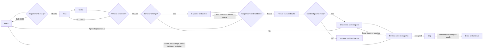

# Compass

**English** | [Tiếng Việt](README.vi.md) | [简体中文](README.zh-CN.md)

[](https://skills.sh/ltphat2204/compass)

**Clear intent. Distributed execution. Verified outcomes.**

Compass is a Spec-Driven Development (SDD) workflow built from nine Agent Skills, with project installation targets for Codex, Claude Code, Cursor, GitHub Copilot and OpenCode: clarify goals, plan the work, implement within scope, and verify outcomes. Each host's execution capabilities and evidence are documented separately. It keeps the same direction across languages, frameworks, and delivery environments, with technical choices grounded in repository evidence.

Skills use the `comp-` prefix. Start the full workflow with `$comp-engineer`, or invoke individual skills to resume existing artifacts.

## Why Compass exists

AI can generate code faster than a developer can understand what was built or verify that it solves the right problem. A newcomer may get a working result without understanding its behavior or limits. An experienced developer may still have to do all the analysis, split the work, anticipate edge cases, and tell AI every next step. Compass was created to address both gaps.

**The guiding principle: help newcomers understand what they are building, and help experienced developers make full use of AI's reasoning.**

For newcomers, Compass connects an idea to concrete behavior, explains meaningful decisions, and shows how the result is verified. For experienced developers, AI investigates the codebase, challenges assumptions, compares approaches, proposes a recommendation, and carries authorized work through verification. The user owns the goal and consequential product choices; AI takes responsibility for the engineering analysis and execution within that scope.

The workflow should work even when someone only has a symptom, an unclear idea, or a milestone-sized goal. It adapts the amount of discussion and documentation to the situation, keeps the next step understandable, and uses evidence to decide whether the work is complete.

## Philosophy

**Goals provide direction; evidence determines the next step.** Compass keeps responsibilities and quality gates consistent while adapting execution to the work's size, risk, and available tools.

1. **Intent before implementation.** Define the problem, scope, constraints, and observable success criteria. Inspect the repository first; ask when a material decision cannot be inferred.
2. **Evidence before prescription.** Use existing architecture, conventions, toolchain, and CI. Do not impose a stack, architectural layer, or dependency the task does not need.
3. **The smallest change that fully solves the task.** Reuse existing patterns. Scale safeguards to behavioral and data impact, rather than diff size.
4. **Distributed execution with clear accountability.** The coordinator assigns work, integrates changes, and decides DONE. Implementers work autonomously within assigned scope; reviewers check independently.
5. **Verification demonstrates outcomes.** Every criterion has a check and actual evidence. Worker reports, missing tools, and skipped checks do not automatically count as a pass.
6. **Traceability survives change.** Preserve intent → plan → task → evidence → delivery links, stable IDs, decisions, notes, and history when resuming or replanning.
7. **Autonomy follows authorization.** Continue safe work within the assigned scope. Merges, deployments, destructive data changes, and externally consequential actions follow existing authorization and project rules.

## Start from the situation

Describe the outcome or problem to `$comp-engineer`; you do not need to choose stages. AI investigates, recommends the next step with a concrete before/after example, and asks only about consequential choices it cannot infer. Newcomers see what they are building and how it is checked; experienced developers get evidence-backed recommendations and challenged assumptions without driving every step.

| Request | Workflow |
|---|---|
| Start quickly | Smallest useful slice, project defaults, concise light artifacts; no interview if already clear |
| Fix something | Diagnose/reproduce, establish expected behavior, smallest shared fix and regression evidence |
| Not sure what to build | Ground the problem, propose an example and next step; bounded discovery before product commitment |
| Deliver a milestone | Parent outcome map → dependency-ordered child intents → child delivery → milestone integration checks |
| Resume or change direction | Preserve valid evidence and IDs; revisit only affected decisions and gates |
| Review or plan only | Stop at the requested handoff |

Low-risk non-behavior corrections can finish inline without feature folders. Behavior changes still require the strict testing/context-separation gates below, even for quick fixes; a shared filesystem does not block implementation. Milestone planning details the next ready child, not every future task. Delivering children does not complete the parent until its integration and acceptance checks pass. See [adaptive routing and decomposition](.agents/skills/comp-engineer/references/adaptive-workflow.md).

## Testing philosophy

**Hotfixes still need tests.** Urgency narrows the scope and ceremony; it does not justify a blind fix. A behavior-changing hotfix establishes the expected behavior and includes a regression test that detects the defect, with a failing baseline when reproducible and passing evidence after the repair. If reproduction is unavailable, record that limit and the evidence used; do not claim the original failure was reproduced. Tests must check the agreed behavior, not merely mirror the patch. The independent review, freeze, and context-separation gates below still apply; missing prerequisites block behavior implementation, and missing verification prevents claiming the fix is complete.

Before freeze, a mandatory fresh independent test reviewer derives expected results from the complete agreed intent/plan, maps rules to actual assertions in both directions, and inspects coordinator-run harness checks plus correct/defective controls for changed non-trivial business rules. Only `Test validation: PASS` for the exact source/suite snapshot permits freeze. Test author self-approval, hashes, or green runs alone are insufficient; missing reviewer or evidence blocks the gate.

Compass uses acceptance criteria and business rules to decide what to test. After Intent → Plan → Tasks, a separate test-author subagent writes tests from a minimal agreed spec/contract packet. Tests are reviewed and frozen before a fresh implementation subagent starts. No percentage coverage target is added; existing repository gates still apply.

Implementers are instructed not to inspect tests, fixtures, assertions, test history, or reports exposing private cases, and must not change/run the frozen suite. Coordinator supplies sanitized contexts and test-read guidance, freezes inventory/hashes against intent/plan versions, runs checks privately, and returns criterion-level feedback. Subagents may share a filesystem and host permissions; host-enforced isolation is optional, and its absence does not block implementation. Required delegation, independent validation and freeze still apply, including light mode. Any frozen-test or expectation-affecting resource change requires complete intent and plan revision, task/evidence reconciliation, and a newly reviewed/frozen suite; preserve the old version and history.

Test business logic at the lowest useful layer, integration boundaries when changed, and critical journeys when needed. Visual/subjective outcomes can use justified manual checks. After implementation closes, walkthrough explains representative test evidence to newcomers; experienced developers use AI to challenge domain assumptions and relevant failure cases. Keep private test evidence out of resumed implementer context. The pre-implementation test gate uses existing artifacts, not an extra skill or test-plan document. See [strict testing guidance and research sources](.agents/skills/comp-implement/references/testing.md).

## Workflow and skills



`comp-engineer` coordinates six stages: `Intent → Plan → Tasks → Implement → Ship → Done`. Analyze and Review are quality gates at handoffs. They can run independently without starting implementation or shipping.

| Skill | When to use | Main outcome |
|---|---|---|
| [comp-engineer](.agents/skills/comp-engineer/SKILL.md) | Full lifecycle or resuming from artifacts | Stage, gate, and handoff coordination |
| [comp-intent](.agents/skills/comp-intent/SKILL.md) | Unclear ideas or requirements that need repository evidence | `intent.md`, criteria, and decisions |
| [comp-plan](.agents/skills/comp-plan/SKILL.md) | Intent is clear enough to choose an approach | `plan.md`, verification/review gates, and task handoff |
| [comp-tasks](.agents/skills/comp-tasks/SKILL.md) | Breaking down work or updating coverage while preserving progress | `tasks.md`, dependencies, and write ownership |
| [comp-analyze](.agents/skills/comp-analyze/SKILL.md) | Checking requirements or consistency | Read-only report, READY/BLOCKED, and findings |
| [comp-implement](.agents/skills/comp-implement/SKILL.md) | Behavior: validated frozen tests and sanitized contexts; other work: ready tasks | Verified changes, progress, and walkthrough |
| [comp-review](.agents/skills/comp-review/SKILL.md) | Reviewing compliance and change quality | Snapshot review, findings, and gate status |
| [comp-ship](.agents/skills/comp-ship/SKILL.md) | Checking and handing off completed work | Delivery evidence, review/CI where applicable |
| [comp-done](.agents/skills/comp-done/SKILL.md) | Confirmed delivery or accepted local completion | Archived artifacts without overwriting history |

## Install through skills.sh

From the **target project**, choose an agent and install all nine skills to preserve sibling references:

```sh
npx skills add ltphat2204/compass --skill '*' --agent claude-code --copy
```

Replace `claude-code` with `codex`, `cursor`, `github-copilot`, or another agent supported by the CLI. The default scope is the project; omit `--global` when Compass should stay in the current project. The skills CLI installs skills/resources only; use the project installer below for supported native roles, or the Claude plugin route. Choose one installation route per host/project to avoid duplicates and ownership collisions.

Preview the list without installing:

```sh
npx skills add ltphat2204/compass --list
```

The GitHub repository is the distribution source. skills.sh discovers skills through installations with telemetry; there is no separate package upload. Directory listing timing depends on the indexing system. [skills CLI](https://github.com/vercel-labs/skills), [skills.sh FAQ](https://www.skills.sh/docs/faq).

## Installation and agent integration

The canonical source is `.agents/skills/`; hosts share the same instructions and resources. Claude Code also has a [plugin manifest](.claude-plugin/plugin.json) and three native roles in [agents/](agents/comp-implementer.md). Adding hosts does not change the workflow's lifecycle or authority.

### Prepare a checkout

Use an existing checkout or clone the public repository:

```sh
git clone https://github.com/ltphat2204/compass.git
cd compass
```

### Claude Code: load the plugin for a session

Run from the project you want to work on, passing the absolute path to the Compass checkout:

```sh
claude --plugin-dir /absolute/path/to/compass
```

In that session:

```text
/compass:comp-engineer Clarify intent, create plan/tasks, implement, and verify.
Allow scoped implementers and an independent reviewer; hand off locally.
```

Claude can use `compass:comp-test-author`, `compass:comp-implementer`, and `compass:comp-reviewer` for the corresponding packets. The reviewer has Read/Glob/Grep only; the coordinator runs checks and supplies review evidence. Roles do not grant themselves permission to commit/push/deploy or exceed write scope. Loading with the flag applies only to that session; it does not install globally or register a marketplace. [Claude plugin loading](https://code.claude.com/docs/en/plugins/create), [subagent tools](https://code.claude.com/docs/en/sub-agents).

The manifest points directly to the canonical skill directory, avoiding separate instruction copies. The default `agents/` layout lets Claude discover native roles. [Manifest paths](https://code.claude.com/docs/en/plugins-reference).

### Install skills into a specific project

From the Compass checkout, use Python 3.9+ and choose a host and an existing target project:

```sh
python3 scripts/install.py --agent codex --project /absolute/path/to/project
python3 scripts/install.py --agent claude --project /absolute/path/to/project
python3 scripts/install.py --agent cursor --project /absolute/path/to/project
python3 scripts/install.py --agent copilot --project /absolute/path/to/project
python3 scripts/install.py --agent opencode --project /absolute/path/to/project
```

Choose one line for your host. The script installs all nine skills/resources and native roles for Codex, Claude and OpenCode. It requires an existing `--project`, has no global mode, does not change host configuration, and refuses collisions or redirected paths. Source role responsibilities remain in `agents/`; adapters change metadata only. Cursor and Copilot use shared role packets without an unverified native wrapper.

Preview first, then explicitly check, update or uninstall the selected project's managed payload:

```sh
python3 scripts/install.py --agent codex --project /absolute/path/to/project --dry-run
python3 scripts/install.py --agent codex --project /absolute/path/to/project --check
python3 scripts/install.py --agent codex --project /absolute/path/to/project --update --dry-run
python3 scripts/install.py --agent codex --project /absolute/path/to/project --update
python3 scripts/install.py --agent codex --project /absolute/path/to/project --uninstall --dry-run
python3 scripts/install.py --agent codex --project /absolute/path/to/project --uninstall
python3 scripts/check_portability.py
```

Ownership records in `.compass/install-<host>.json` contain source revision and payload hashes. Update/uninstall preflight the whole operation and refuse modified/missing tracked files, conflicting new files, unsafe ownership or symlinks; unrelated files remain. `--dry-run` performs the same checks without writes. Existing copied installations without ownership metadata are not adopted automatically: compare/back up customizations first. There is no `--force`. The portability check also accepts `--root` with a project or installed skill directory.

| Host | Project path created by the installer | Invoke the workflow |
|---|---|---|
| Codex | `.agents/skills/` | Skill selector; CLI/IDE: `$comp-engineer` |
| Claude Code, copied skills | `.claude/skills/` | `/comp-engineer` |
| Claude Code, plugin session | No copying; use `--plugin-dir` | `/compass:comp-engineer` |
| Cursor | `.cursor/skills/` | `/comp-engineer` or select a skill with `@` |
| GitHub Copilot | `.github/skills/` | Ask for `comp-engineer`; CLI: `/comp-engineer` |
| OpenCode | `.opencode/skills/` | Native skill tool/selector; ask for `comp-engineer` |

Codex uses project `.agents/skills`. Cursor also discovers `.agents/skills`; Copilot supports that directory on the surfaces described in its documentation. When working directly in the Compass checkout, these hosts can use the canonical source without copying. Check the skill selector in your host. [Codex discovery](https://learn.chatgpt.com/docs/build-skills), [Cursor skills](https://prod.cursor.com/help/customization/skills), [Copilot skills](https://docs.github.com/en/copilot/concepts/agents/about-agent-skills), [Copilot CLI invocation](https://docs.github.com/en/copilot/reference/copilot-cli-reference/cli-command-reference).

Native project roles are installed under `.codex/agents/` (TOML), `.claude/agents/` or `.opencode/agents/` (Markdown). Claude plugin sessions continue to discover the original roles. Codex roles inherit parent permissions; the read-only reviewer instruction does not create a separate sandbox. OpenCode uses its v1 permission mapping. Avoid loading plugin and copied skills/roles together. [Role mappings, capability matrix and stage preflight](.agents/skills/comp-engineer/references/hosts.md), [portable packets and cross-host resume](.agents/skills/comp-implement/references/packets.md).

Installation, native discovery, full model workflow and cross-host resume are separate evidence levels. Check [evaluation results](evals/results.md) for actual versions, runs and blockers. A host that can read skills may still lack the fresh delegation or independent validation required for behavior implementation; plan/analyze and other unblocked authorized work can continue.

Full-workflow verification covers **Codex, OpenCode and Claude Code**, with the limits recorded in [evaluation results](evals/results.md#harness-portability--scoped-delivery-2026-10-18). **Cursor and GitHub Copilot are supported but runtime-unverified**: project installation and resource/lifecycle checks are available; native discovery, delegation and full workflows have not been verified. Their runtime checks remain pending.

### SkCC and skill-sync (optional)

Keep `.agents/skills/` as the canonical source. [SkCC](https://github.com/Nexa-Language/Skill-Compiler) is a compiler for Claude/Codex/Gemini/Kimi; use it only when a host needs a separate output. Its optimization/constraint injection steps mean output must be reviewed for semantics, sibling links, and resources before replacing Compass instructions. Successful compilation alone does not establish equivalent workflow behavior.

Several projects are named `skill-sync`. [joeharris76/skill-sync](https://github.com/joeharris76/skill-sync) fits project distribution: select a local Git catalog, skills, and revision, preview before applying, then review the diff and verify the committed payload. Sync all nine sibling packages, pin a specific commit, and declare targets only for the selected project. The catalog must have a commit containing the skills; Git archive does not distribute uncommitted files.

The [example profile](integrations/skill-sync.conf.example) is specifically for `joeharris76/skill-sync` and pins a verified source revision. Preview from the Compass checkout before applying:

```sh
skill-sync preview -C . -f integrations/skill-sync.conf.example
```

For another project, change `source` to the Compass checkout path and confirm that all three targets fit that project. The profile has not been executed with the upstream tool; it does not enable syncing or replace existing configuration automatically.

Some similarly named tools focus on user-level roots or select a winner by version/mtime across a mesh. They are not Compass defaults. Neither of the two tools above has been installed/run in this project; the local installer and skills CLI remain the verified distribution paths. Do not add dependencies or global watchers merely to enable optional integration.

### Other agents

Agents that support Agent Skills can receive all nine directories from `.agents/skills/` in their documented discovery path. Without discovery, ask the agent to read `comp-engineer/SKILL.md` from the checkout, then load relevant skills/references on demand. This is manual instruction use, not a claim that a native plugin was tested on that host.

Each host uses its own APIs/tools, repository instructions, and permission model. Do not assume Codex tool names, `$` syntax, subagent APIs, or workspace isolation are identical. For behavior work, missing delegation blocks implementation; inline/serial fallback applies only to non-behavior work; without a required reviewer, the gate remains PENDING. See [Host Integration](.agents/skills/comp-engineer/references/hosts.md) for mappings.

### Updates and limits

Update prompts/shortcuts that still use the old prefix; keep existing `dev/` artifacts, task IDs, and history. Plugin sessions read the canonical source; use `/reload-plugins` after changing the plugin in Claude. Upgrade copied skills deliberately after comparing customizations; they do not sync automatically between projects. [Claude reload](https://code.claude.com/docs/en/plugins/create).

Compass does not require an MCP server, hooks, or a new application runtime. Python is only for the installer/checks; RTK, CodeGraph, Ponytail, and specific review/CI tools are optional. Behavior implementation requires fresh test-author, independent test-review, and implementation subagents plus sanitized context and instructions not to inspect tests; a host lacking these capabilities can still plan/review or perform non-behavior work, but must block behavior implementation. Do not enable experimental agent teams or relax permissions to bypass the gate.

## Usage

The `$comp-*` examples below use Codex syntax. With the Claude plugin, use `/compass:comp-*`; with copied Claude skills or Cursor, use `/comp-*`. On other hosts, use the skill selector or ask the agent to read the corresponding skill.

### Assign the full workflow

```text
$comp-engineer Add data export to this CLI. Clarify intent from the repository,
choose a mode based on risk, create plan/tasks, then implement and verify.
Allow scoped subagents and an independent reviewer; hand off locally when done.
```

The coordinator gathers actual context, asks about missing decisions, and chooses the next step from artifacts. Ship can mean a local handoff; this prompt does not authorize deployment or remote merging.

### Invoke individual stages or resume

```text
$comp-intent Clarify CLI retry requirements; write intent in dev/cli-retry/.
$comp-plan Plan from dev/cli-retry/intent.md in the same folder.
$comp-tasks Update tasks from dev/cli-retry/ intent/plan; preserve IDs and progress.
$comp-analyze Check dev/cli-retry/ consistency before implementation; report only.
$comp-implement Execute ready tasks in dev/cli-retry/.
$comp-review Review changes against dev/cli-retry/ on the current snapshot; report only.
$comp-ship Check and hand off dev/cli-retry/ locally with existing evidence.
```

Invoke `$comp-done` after confirmed delivery or accepted local completion. Choose the stage that matches the request; a review request does not automatically run the entire lifecycle.

## Use cases

| Situation | Approach | Expected outcome |
|---|---|---|
| Feature spanning multiple components | `comp-engineer`, standard; authorize subagents | Dependency-aware tasks, clear ownership, combined verification, and independent review |
| Small bug with a clear reproduction | `comp-engineer`, light; or `comp-implement` when tasks exist | Small change, verified reproduction, and checks of affected scope |
| Vague idea | `comp-intent`, `comp-analyze` requirements | Observable criteria; material decisions clarified before planning |
| Feasibility assessment | `comp-engineer`, timeboxed spike | Learning plan/checklist in intent, evidence, and stop/go; production code is not assumed |
| Library or CLI refactor | Plan → Tasks → Implement → Review | Preserved contracts, caller checks, and before/after behavior verified with the existing toolchain |
| Security or data changes | Standard with impact-based gates | Failure/recovery evidence, task review, and policy-required reviewers; missing review remains PENDING |
| Code/artifact review only | `comp-review` or `comp-analyze` | Sourced findings, read-only; no tracker edits or shipping |
| Resume after scope changes | `comp-plan`, `comp-tasks` on existing artifacts | Preserve valid DONE work; reopen affected work and dependent checks while keeping history |
| Documentation or repositories without CI/remotes | Mode based on size, appropriate checks, local handoff | Content/link validation or manual evidence; no extra stack |

Spike example:

```text
$comp-engineer Use a 30-minute spike to assess whether the parser can handle
the target input. Provide evidence and a stop/go recommendation only;
state measurement limits and do not implement for production.
```

## Working examples

Three task managers demonstrate Compass with increasing integration complexity. Each has a Vietnamese UI, local setup instructions, verification evidence, and an actual skill/prompt history.

| Example | Stack and scope |
|---|---|
| [React + Vite](example/react-vite/README.md) | Browser-only CRUD, filters, and localStorage persistence |
| [Next.js full stack](example/nextjs-fullstack/README.md) | App Router, Route Handlers, and server-side SQLite |
| [Next.js + NestJS monorepo](example/nextjs-nestjs-monorepo/README.md) | pnpm workspace, separate web/API apps, shared TypeScript contracts, and SQLite |

See the [example guide](example/README.md) (Vietnamese) for requirements, workflow history, and recorded results. All three were verified locally; production deployment and Safari/Firefox checks are outside the recorded verification.

## Artifacts and modes

The default folder is `dev/{feature-slug}/`; an existing or user-selected root is preserved throughout the workflow.

```text
dev/{feature-slug}/
├── intent.md       # Problem, scope, criteria, project context, decisions
├── plan.md         # Approach, dependencies, verification, review gates
├── tasks.md        # Stable IDs, owners, write scope, status, progress
└── walkthrough.md  # Actual changes, attempts, checks, review, limitations
```

| Mode | Artifacts | Suitable for |
|---|---|---|
| Standard | Intent, plan with five substantive sections, tasks, walkthrough | Substantial or risky work |
| Light | Compact intent/plan/tasks/walkthrough; combine appropriate sections and omit empty phases | Bounded changes with the same mandatory gates |
| Spike | Intent contains the learning plan/checklist; walkthrough records results | Bounded learning; a new scope is required before production implementation |

Mode adjusts documentation volume; risk determines verification and reviewers. A small diff can still be high risk. `comp-done` archives to `_archived/YYYYMMDD/{feature-slug}/`, avoiding overwrites of existing work.

## Subagents and reviewers

Behavior work follows the strict test-author → independent validation → freeze/context separation → implementer sequence above, overriding inline fallback. Use fresh sanitized contexts and instructions not to inspect tests; shared filesystems are supported without host access controls.

The coordinator owns assignments, integration, `tasks.md`, `walkthrough.md`, progress, and DONE decisions. Standard work uses scoped implementers when tools and authorization allow; tightly coupled work or work too small to split runs inline/serially.

Workers receive a minimal packet: criteria, baseline, required reading context, write scope, dependencies, deliverable, verification commands, and blocker conditions. They return actual diffs and results; they do not edit shared artifacts, restart the lifecycle, or commit/push outside an authorized assignment.

Run tasks concurrently only when dependencies are ready, contracts are settled, and write scopes/resources are independent, including tests, configuration, and generated outputs. Each file/resource has one active writer. Worker count follows the environment's concurrency limit, including the coordinator.

The coordinator inspects actual changes and runs combined integration checks. Security/data/public-contract/prerequisite tasks need review before DONE or unlocking dependencies; other tasks can be reviewed at milestones.

Before Ship, use an independent reviewer with fresh context when available and authorized. Reviewers check compliance and change quality against a stable snapshot. Changed inputs invalidate related approvals. Self-review fallback is allowed only by risk and policy; a subagent does not replace a specifically required human reviewer. See the [delegation protocol](.agents/skills/comp-implement/references/delegation.md).

## Quality gates and conflicts

- **Before Plan:** clear requirements, observable outcomes, scope/failure expectations, and explicit assumptions.
- **Before Implement:** criteria → plan → tasks → verification coverage; consistent scope, constraints, and dependencies.
- **Before behavior implementation:** independent test validation PASS for the agreed source/suite snapshot, frozen inventory/hashes, and documented test-read guidance and sanitized context.
- **Before Ship:** current evidence, reviewed compliance/change quality, and passed mandatory gates.

Standalone analysis/review/readiness is read-only. When executing an assigned stage, the coordinator records scope, findings, and gate status in artifacts. BLOCKERs, missing evidence, or missing required reviewers block the corresponding stage; they cannot be recorded as a pass. Low risk permits labeled self-review; medium risk needs caller/integration checks and policy-required reviewers; high risk needs independent or human review.

Agreed intent defines outcomes; mandatory project instructions/constitution constrain the solution; plans/tasks implement intent; existing code provides evidence. Material conflicts require an authorized owner's decision with rationale and a scoped exception, rather than silently dropping a rule. Platform instructions and authorization retain higher priority.

## Skill verification

C11-C15 in [evaluation cases](evals/cases.md) cover acceptance/business-rule test generation, self-confirming tests, frozen-suite changes, test-read guidance, and independent validation against agreed rules. [Results](evals/results.md) distinguish isolated fixture checks from independent model evaluation.

[Evaluation cases](evals/cases.md) describe eight behavioral scenarios and two integration/distribution cases: ambiguous requirements, conflicting artifacts, high-risk review, repository-rule conflicts, replanning with history preservation, bounded spikes, delegated implementation, unavailable-tool/reviewer fallback, host packaging/project isolation, and public skills.sh distribution. [Evaluation results](evals/results.md) record actual outcomes, corrections, and verification limits.

Validators check packaging/frontmatter; behavioral evaluations check decisions, changes, and evidence. C7 used three implementers and one independent reviewer on a small Python fixture; this does not establish correctness on arbitrary repositories or race safety during concurrent execution. Renaming skills does not mean the behavioral cases were rerun.

Local integration checks:

```sh
claude plugin validate --strict .
claude plugin validate --strict agents
claude --plugin-dir . plugin details compass
PYTHONDONTWRITEBYTECODE=1 python3 -m unittest discover -s evals -p 'test_*.py' -v
```

Claude CLI checks do not call a model. See [integration results](evals/results.md) to distinguish verified manifest/discovery behavior from host behavioral execution that has not been run.
