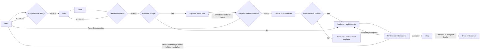

# Compass

[English](README.md) | **Tiếng Việt** | [简体中文](README.zh-CN.md)

[](https://skills.sh/ltphat2204/compass)

**Clear intent. Distributed execution. Verified outcomes.**

Compass là workflow Spec-Driven Development (SDD) gồm chín Agent Skills dùng trên Codex, Claude Code, Cursor và GitHub Copilot: làm rõ mục tiêu, lập kế hoạch, triển khai theo phạm vi và kiểm chứng kết quả. Workflow giữ cùng định hướng trên nhiều ngôn ngữ, framework và môi trường delivery; lựa chọn kỹ thuật dựa trên bằng chứng từ repository.

Tiền tố skill là `comp-`. Bắt đầu công việc xuyên suốt bằng `$comp-engineer`, hoặc gọi từng skill để tiếp tục artifacts hiện có.

## Philosophy

**Mục tiêu làm la bàn, bằng chứng quyết định bước tiếp theo.** Compass giữ trách nhiệm và quality gates ổn định; cách thực hiện thích nghi theo quy mô, rủi ro và công cụ thực tế.

1. **Intent trước implementation.** Xác định vấn đề, phạm vi, ràng buộc và tiêu chí thành công quan sát được. Tra cứu repo trước; hỏi khi còn quyết định quan trọng không thể suy ra.
2. **Evidence trước prescription.** Dùng kiến trúc, conventions, toolchain và CI đang có. Không áp đặt stack, tầng kiến trúc hoặc dependency khi nhiệm vụ không cần.
3. **Thay đổi nhỏ nhất giải quyết đủ yêu cầu.** Tái sử dụng pattern hiện có; safeguards theo tác động đến hành vi và dữ liệu, không theo số dòng diff.
4. **Phân tán thực thi, giữ trách nhiệm rõ ràng.** Coordinator điều phối, tích hợp và quyết định DONE. Implementer tự chủ trong scope được giao; reviewer kiểm tra độc lập.
5. **Verification chứng minh outcome.** Mỗi tiêu chí có check và bằng chứng thực tế. Báo cáo worker, công cụ thiếu và check bị bỏ qua không tự trở thành pass.
6. **Traceability tồn tại qua thay đổi.** Giữ liên kết intent → plan → task → evidence → delivery; giữ ID, quyết định, ghi chú và lịch sử khi resume/replan.
7. **Autonomy theo authorization.** Tiếp tục công việc an toàn trong phạm vi đã giao. Merge, deploy, thay đổi dữ liệu phá hủy và hành động có hệ quả bên ngoài tuân theo quyền hạn và quy tắc dự án.

## Triết lý kiểm thử

Trước freeze, bắt buộc có subagent reviewer độc lập với context mới: tự suy ra expected result từ toàn bộ intent/plan đã chốt, nối quy tắc với assertion theo cả hai chiều, kiểm tra runner và evidence từ control đúng/sai cho business rule thay đổi có logic đáng kể. Chỉ `Test validation: PASS` gắn với đúng snapshot nguồn/test mới cho phép freeze. Test author tự duyệt, hash hoặc test xanh không đủ; thiếu reviewer/evidence thì BLOCKED.

Compass chọn test theo acceptance criteria và quy tắc nghiệp vụ. Sau Intent → Plan → Tasks, một subagent riêng viết test từ packet tối thiểu gồm spec/contract đã chốt. Test được review và freeze trước khi subagent implement bắt đầu với context mới. Không đặt thêm mục tiêu phần trăm coverage; quality gates sẵn có của repo vẫn được giữ.

Implementer không được đọc test, fixture, assertion, lịch sử test hay báo cáo lộ private case; không được sửa/chạy bộ test đã freeze. Coordinator xác minh quyền đọc được host chặn thực sự, freeze inventory/hash gắn với phiên bản intent/plan, chạy test riêng và chỉ trả feedback ở mức criterion. Folder/worktree riêng hoặc lời nhắc trong prompt không đủ bảo đảm cô lập; thiếu delegation/isolation thì BLOCKED cho cả light mode. Mọi sửa đổi test hoặc tài nguyên ảnh hưởng expected result sau freeze đều phải rà soát và chốt lại toàn bộ intent, plan, reconcile tasks/evidence rồi sinh bộ test mới để review/freeze; giữ nguyên phiên bản cũ và lịch sử.

Test business logic ở tầng thấp nhất đủ chứng minh quy tắc, integration cho boundary thay đổi và E2E cho hành trình cần thiết. Kết quả hình ảnh/cảm nhận có thể dùng manual check có lý do. Sau khi đóng implementation, walkthrough giải thích test tiêu biểu cho fresher; experienced dev dùng AI phản biện giả định và failure case. Không đưa evidence riêng của test vào context implementer khi resume. Gate test trước implementation dùng artifacts hiện có, không thêm skill hay tài liệu test-plan riêng. Xem [hướng dẫn strict testing và nguồn nghiên cứu](.agents/skills/comp-implement/references/testing.md).

## Workflow và skills



`comp-engineer` điều phối sáu stage `Intent → Plan → Tasks → Implement → Ship → Done`. Analyze và Review là quality gates tại các handoff; có thể gọi riêng mà không bắt đầu implementation hoặc shipping.

| Skill | Khi dùng | Kết quả chính |
|---|---|---|
| [comp-engineer](.agents/skills/comp-engineer/SKILL.md) | Lifecycle xuyên suốt hoặc resume từ artifacts | Điều phối stage, gate và handoff |
| [comp-intent](.agents/skills/comp-intent/SKILL.md) | Ý tưởng chưa rõ, yêu cầu cần gắn với repo evidence | `intent.md`, criteria và quyết định |
| [comp-plan](.agents/skills/comp-plan/SKILL.md) | Intent đủ rõ để chọn cách triển khai | `plan.md`, verification/review gates, task handoff |
| [comp-tasks](.agents/skills/comp-tasks/SKILL.md) | Chia việc hoặc cập nhật coverage mà giữ tiến độ | `tasks.md`, dependencies và write ownership |
| [comp-analyze](.agents/skills/comp-analyze/SKILL.md) | Kiểm tra requirements hoặc consistency | Báo cáo read-only, READY/BLOCKED và findings |
| [comp-implement](.agents/skills/comp-implement/SKILL.md) | Hành vi: test đã validation/freeze và isolation; việc khác: task sẵn sàng | Thay đổi đã kiểm chứng, progress và walkthrough |
| [comp-review](.agents/skills/comp-review/SKILL.md) | Review compliance và chất lượng thay đổi | Snapshot review, findings và gate status |
| [comp-ship](.agents/skills/comp-ship/SKILL.md) | Kiểm tra và bàn giao công việc hoàn thành | Delivery evidence, review/CI khi áp dụng |
| [comp-done](.agents/skills/comp-done/SKILL.md) | Delivery xác nhận hoặc hoàn thành local được chấp nhận | Archive artifacts, không ghi đè lịch sử |

## Cài qua skills.sh

Từ **project đích**, chọn agent và cài đủ chín skill để giữ sibling references:

```sh
npx skills add ltphat2204/compass --skill '*' --agent claude-code --copy
```

Thay `claude-code` bằng `codex`, `cursor`, `github-copilot` hoặc agent mà CLI hỗ trợ. Scope mặc định là project; không thêm `--global` khi chỉ muốn Compass ở project hiện tại. Cài qua skills CLI chỉ mang skills/resources; native Claude roles cần plugin route bên dưới.

Xem trước danh sách mà không cài:

```sh
npx skills add ltphat2204/compass --list
```

Repo GitHub là nguồn phân phối; skills.sh ghi nhận skill qua lượt cài có telemetry, không có bước upload package riêng. Thời điểm xuất hiện trong danh mục phụ thuộc hệ thống indexing. [skills CLI](https://github.com/vercel-labs/skills), [skills.sh FAQ](https://www.skills.sh/docs/faq).

## Cài đặt và tích hợp agent

Canonical source là `.agents/skills/`; các host dùng cùng instructions và resources. Claude Code có thêm [plugin manifest](.claude-plugin/plugin.json) và ba native role trong [agents/](agents/comp-implementer.md). Mở rộng host không thay lifecycle hoặc quyền hạn của workflow.

### Chuẩn bị checkout

Dùng checkout hiện có hoặc clone repository public:

```sh
git clone https://github.com/ltphat2204/compass.git
cd compass
```

### Claude Code: chạy plugin theo session

Chạy từ project bạn muốn làm việc, truyền đường dẫn tuyệt đối tới checkout Compass:

```sh
claude --plugin-dir /absolute/path/to/compass
```

Trong session đó:

```text
/compass:comp-engineer Làm rõ intent, lập plan/tasks, triển khai và kiểm chứng.
Cho phép scoped implementers và reviewer độc lập; bàn giao local.
```

Claude có thể dùng `compass:comp-test-author`, `compass:comp-implementer` và `compass:comp-reviewer` cho packet tương ứng. Reviewer chỉ có Read/Glob/Grep; coordinator chạy checks rồi cung cấp evidence cho review. Các role không tự cấp quyền commit/push/deploy hoặc vượt write scope. Plugin load bằng flag chỉ áp dụng cho session; không cài global hoặc đăng ký marketplace. [Claude plugin loading](https://code.claude.com/docs/en/plugins/create), [subagent tools](https://code.claude.com/docs/en/sub-agents).

Manifest trỏ thẳng tới canonical skill directory; không duy trì bản sao instructions riêng. Dùng layout `agents/` mặc định để Claude khám phá native roles. [Manifest paths](https://code.claude.com/docs/en/plugins-reference).

### Cài skill vào một project cụ thể

Từ checkout Compass, dùng Python 3.9+ và chọn host cùng project đích đã tồn tại:

```sh
python3 scripts/install.py --agent codex --project /absolute/path/to/project
python3 scripts/install.py --agent claude --project /absolute/path/to/project
python3 scripts/install.py --agent cursor --project /absolute/path/to/project
python3 scripts/install.py --agent copilot --project /absolute/path/to/project
```

Chọn một dòng cho host cần dùng. Script copy đủ chín skill và resources, kiểm tra trùng tên trước khi ghi, từ chối đích redirect ra ngoài project và dọn những skill nó vừa tạo nếu copy lỗi. Script yêu cầu `--project`, không có chế độ global và không sửa cấu hình host. Nếu đã có skill cùng tên, so sánh/sao lưu bản tùy chỉnh trước khi tự thay thế; không có `--force`.

| Host | Đường dẫn project do installer tạo | Gọi workflow |
|---|---|---|
| Codex | `.agents/skills/` | Skill selector; CLI/IDE: `$comp-engineer` |
| Claude Code, skill copy | `.claude/skills/` | `/comp-engineer` |
| Claude Code, plugin session | Không copy; dùng `--plugin-dir` | `/compass:comp-engineer` |
| Cursor | `.cursor/skills/` | `/comp-engineer` hoặc chọn skill bằng `@` |
| GitHub Copilot | `.github/skills/` | Yêu cầu dùng `comp-engineer`; CLI: `/comp-engineer` |

Codex dùng project `.agents/skills`. Cursor cũng khám phá `.agents/skills`; Copilot hỗ trợ thư mục này trên các surface được tài liệu mô tả. Khi làm việc ngay trong checkout Compass, các host đó có thể dùng canonical source mà không copy. Kiểm tra skill selector trên host đang dùng. [Codex discovery](https://learn.chatgpt.com/docs/build-skills), [Cursor skills](https://prod.cursor.com/help/customization/skills), [Copilot skills](https://docs.github.com/en/copilot/concepts/agents/about-agent-skills), [Copilot CLI invocation](https://docs.github.com/en/copilot/reference/copilot-cli-reference/cli-command-reference).

Cài bằng script chỉ copy skills, không copy native Claude roles. Muốn ba role đó, dùng plugin session. Tránh vừa load plugin vừa copy cùng bộ skill cho một session để giữ cách gọi rõ ràng.

### SkCC và skill-sync (tùy chọn)

Giữ `.agents/skills/` làm canonical source. [SkCC](https://github.com/Nexa-Language/Skill-Compiler) là compiler cho Claude/Codex/Gemini/Kimi; chỉ dùng khi cần output riêng cho host. Nó có bước tối ưu/inject constraints, nên output phải được review về semantics, sibling links và resources trước khi thay instructions của Compass. Không mặc định coi compile thành công là workflow tương đương.

Có nhiều dự án tên `skill-sync`. Bản [joeharris76/skill-sync](https://github.com/joeharris76/skill-sync) phù hợp với phân phối theo project: chọn local Git catalog, skill và revision, preview trước apply, rồi review diff và verify payload đã commit. Sync toàn bộ chín sibling packages, pin commit cụ thể, chỉ khai báo target của project được chọn. Bản catalog phải có commit chứa skills; file chưa commit không được Git archive phân phối.

[Profile mẫu](integrations/skill-sync.conf.example) dành riêng cho bản `joeharris76/skill-sync`, pin revision source đã được kiểm chứng. Chạy preview từ checkout Compass trước khi apply:

```sh
skill-sync preview -C . -f integrations/skill-sync.conf.example
```

Nếu dùng trong project khác, sửa `source` thành đường dẫn checkout Compass và xác nhận ba target phù hợp project đó. Profile chưa được chạy bằng tool upstream; không tự bật sync hoặc thay thế cấu hình đang có.

Một số bản cùng tên tập trung vào user-level roots hoặc chọn winner theo version/mtime trong mesh. Chúng không phải lựa chọn mặc định cho Compass. Hai tool trên chưa được cài/chạy trong project này; installer local và skills CLI vẫn là đường phân phối đã kiểm chứng. Không thêm dependency hoặc watcher global để bật tích hợp tùy chọn.

### Các agent khác

Agent hỗ trợ Agent Skills có thể nhận toàn bộ chín thư mục từ `.agents/skills/` vào đường dẫn discovery mà host đó quy định. Nếu không có discovery, yêu cầu agent đọc `comp-engineer/SKILL.md` từ checkout rồi chỉ tải skill/reference liên quan theo nhu cầu. Đây là cách sử dụng instructions thủ công, không phải tuyên bố plugin native đã được kiểm thử trên host đó.

Mỗi host dùng API/tools, repository instructions và permission model của nó. Không giả định tên tool Codex, cú pháp `$`, subagent API hoặc workspace isolation giống nhau. Thay đổi hành vi thiếu delegation hoặc cơ chế chặn đọc test thì BLOCKED; inline/serial chỉ áp dụng cho việc không đổi hành vi; thiếu reviewer bắt buộc vẫn PENDING. Hướng dẫn mapping nằm trong [Host Integration](.agents/skills/comp-engineer/references/hosts.md).

### Cập nhật và giới hạn

Cập nhật prompt/shortcut đang trỏ tới tiền tố cũ; artifacts `dev/`, task ID và lịch sử vẫn dùng tiếp. Plugin session đọc canonical source; khi sửa plugin trong Claude, dùng `/reload-plugins`. Bản skill copy được nâng cấp có chủ ý sau khi so sánh tùy chỉnh, không tự đồng bộ giữa project. [Claude reload](https://code.claude.com/docs/en/plugins/create).

Compass không yêu cầu MCP server, hooks hoặc runtime ứng dụng mới. Python chỉ dùng cho installer/checks; RTK, CodeGraph, Ponytail và tool review/CI cụ thể là tùy chọn. Thay đổi hành vi bắt buộc có subagent test author, reviewer test độc lập và implementer với context mới, cùng cơ chế chặn đọc test thực sự. Host thiếu khả năng này vẫn có thể plan/review hoặc làm việc không đổi hành vi, nhưng phải BLOCKED khi implement hành vi. Không bật experimental agent teams hay nới permissions để bỏ qua gate.

## Sử dụng

Các ví dụ `$comp-*` dưới đây dùng cú pháp Codex. Với Claude plugin dùng `/compass:comp-*`; với Claude skill copy hoặc Cursor dùng `/comp-*`. Với host khác chọn skill qua selector hoặc yêu cầu đọc skill tương ứng.

### Giao công việc xuyên suốt

```text
$comp-engineer Thêm khả năng export dữ liệu cho CLI này. Làm rõ intent từ repo,
chọn mode theo rủi ro, lập plan/tasks rồi triển khai và kiểm chứng.
Cho phép scoped subagents và reviewer độc lập; bàn giao local sau khi xong.
```

Coordinator tìm context thực tế, hỏi quyết định còn thiếu và chọn bước tiếp theo theo artifacts. Ship có thể là bàn giao local; prompt này không cấp quyền deploy hoặc merge remote.

### Gọi từng stage hoặc resume

```text
$comp-intent Làm rõ yêu cầu retry cho CLI; ghi intent vào dev/cli-retry/.
$comp-plan Lập kế hoạch từ dev/cli-retry/intent.md trong cùng folder.
$comp-tasks Cập nhật task từ intent/plan của dev/cli-retry/; giữ ID và tiến độ.
$comp-analyze Kiểm tra consistency của dev/cli-retry/ trước implementation; chỉ báo cáo.
$comp-implement Thực hiện các task sẵn sàng trong dev/cli-retry/.
$comp-review Review thay đổi theo dev/cli-retry/ trên snapshot hiện tại; chỉ báo cáo.
$comp-ship Kiểm tra và bàn giao local dev/cli-retry/ với bằng chứng hiện có.
```

Gọi `$comp-done` sau delivery đã xác nhận hoặc hoàn thành local được chấp nhận. Chọn stage phù hợp với yêu cầu; một yêu cầu review không tự chạy toàn lifecycle.

## Use cases

| Tình huống | Cách dùng | Kết quả mong đợi |
|---|---|---|
| Feature nhiều thành phần | `comp-engineer`, standard; cho phép subagents | Task theo dependencies, ownership rõ, combined verification và review độc lập |
| Bug nhỏ có reproduction rõ | `comp-engineer`, light; hoặc `comp-implement` khi đã có task | Thay đổi nhỏ, kiểm chứng reproduction và phạm vi bị ảnh hưởng |
| Ý tưởng còn mơ hồ | `comp-intent`, `comp-analyze` requirements | Criteria quan sát được; hỏi quyết định quan trọng trước planning |
| Đánh giá khả thi | `comp-engineer`, spike với timebox | Learning plan/checklist trong intent, bằng chứng và stop/go; không mặc định production code |
| Refactor library hoặc CLI | Plan → Tasks → Implement → Review | Giữ contract, kiểm tra callers và hành vi trước/sau bằng toolchain đang có |
| Đổi bảo mật hoặc dữ liệu | Standard với gates theo tác động | Failure/recovery evidence, task review và reviewer theo policy; thiếu review giữ PENDING |
| Chỉ review code/artifacts | `comp-review` hoặc `comp-analyze` | Findings có nguồn, read-only, không sửa tracker hay ship |
| Resume khi đổi scope | `comp-plan`, `comp-tasks` trên artifacts hiện có | Giữ DONE còn hợp lệ; reopen phần bị ảnh hưởng và checks phụ thuộc, giữ lịch sử |
| Tài liệu hoặc repo không CI/remote | Mode theo quy mô, checks phù hợp, local handoff | Content/link validation hoặc manual evidence; không dựng thêm stack |

Ví dụ spike:

```text
$comp-engineer Dùng spike mode trong 30 phút để đánh giá parser có xử lý
được input mục tiêu hay không. Chỉ cần bằng chứng và khuyến nghị stop/go;
ghi rõ giới hạn đo và không triển khai production.
```

## Artifacts và modes

Folder mặc định là `dev/{feature-slug}/`; root có sẵn hoặc do người dùng chọn được giữ xuyên suốt workflow.

```text
dev/{feature-slug}/
├── intent.md       # Problem, scope, criteria, project context, decisions
├── plan.md         # Approach, dependencies, verification, review gates
├── tasks.md        # Stable IDs, owners, write scope, status, progress
└── walkthrough.md  # Actual changes, attempts, checks, review, limitations
```

| Mode | Artifacts | Phù hợp với |
|---|---|---|
| Standard | Intent, plan năm phần nội dung chính, tasks, walkthrough | Công việc đáng kể hoặc có rủi ro |
| Light | Intent/plan/tasks/walkthrough gọn; gộp phần phù hợp, bỏ phase rỗng | Thay đổi bounded với cùng mandatory gates |
| Spike | Intent chứa learning plan/checklist; walkthrough chứa kết quả | Học có giới hạn; scope mới trước production implementation |

Mode điều chỉnh lượng tài liệu; risk quyết định verification và reviewer. Diff nhỏ vẫn có thể high risk. `comp-done` archive vào `_archived/YYYYMMDD/{feature-slug}/`, tránh ghi đè công việc đã có.

## Subagents và reviewer

Thay đổi hành vi bắt buộc theo test-author → validation độc lập → freeze/isolation → implementer, ưu tiên hơn fallback inline. Prompt của native role không tự tạo môi trường chặn truy cập; phải xác minh khả năng thực tế của host trước khi dispatch.

Coordinator giữ assignments, integration, `tasks.md`, `walkthrough.md`, progress và quyền DONE. Standard work dùng scoped implementers khi có công cụ và được phép; việc gắn chặt hoặc không đáng chia chạy inline/serial.

Worker nhận packet tối thiểu: criteria, baseline, context cần đọc, write scope, dependencies, deliverable, lệnh kiểm chứng và điều kiện báo blocker. Worker trả diff và kết quả thực tế; không tự sửa artifacts chung, khởi động lại lifecycle hoặc commit/push ngoài assignment được phép.

Chỉ chạy đồng thời task đủ dependencies, contract ổn định và write scope/tài nguyên độc lập, kể cả tests, config và generated outputs. Mỗi file/tài nguyên có một writer hoạt động. Số worker theo concurrency của môi trường, tính cả coordinator.

Coordinator đối chiếu thay đổi thực tế và chạy combined integration checks. Task bảo mật/dữ liệu/public contract/prerequisite cần review trước DONE hoặc mở dependencies; các task khác có thể review theo milestone.

Trước Ship, dùng reviewer độc lập với context mới khi có và được phép. Reviewer kiểm tra compliance và change quality trên snapshot ổn định. Input thay đổi vô hiệu hóa approval liên quan. Self-review fallback chỉ khi risk và policy cho phép; subagent không thay reviewer con người được chỉ định bắt buộc. Xem [delegation protocol](.agents/skills/comp-implement/references/delegation.md).

## Quality gates và xung đột

- **Trước Plan:** requirements rõ, observable outcomes, scope/failure expectations và assumptions minh bạch.
- **Trước Implement:** criteria → plan → tasks → verification có coverage; scope, constraints và dependencies nhất quán.
- **Trước implement hành vi:** validation test độc lập PASS cho đúng snapshot nguồn/test, inventory/hash đã freeze và quyền đọc test của implementer được chặn thực sự.
- **Trước Ship:** evidence hiện hành, compliance/change quality được review; mandatory gates đã đạt.

Standalone analysis/review/readiness là read-only. Khi thực thi stage đã giao, coordinator ghi scope, findings và gate status vào artifacts. BLOCKER, thiếu evidence hoặc reviewer bắt buộc ngăn stage tương ứng; không được ghi thành pass. Low risk cho phép labeled self-review; medium risk cần caller/integration checks và reviewer theo policy; high risk cần independent hoặc human review.

Intent được thống nhất xác định outcome; mandatory project instructions/constitution ràng buộc giải pháp; plan/tasks thực hiện intent; code hiện có cung cấp evidence. Xung đột quan trọng cần quyết định của người có thẩm quyền với rationale và scoped exception, không âm thầm bỏ quy tắc. Platform instructions và authorization vẫn có ưu tiên cao hơn.

## Verification của bộ skill

C11-C15 trong [evaluation cases](evals/cases.md) kiểm tra sinh test theo acceptance/business rules, test tự xác nhận code, sửa frozen suite, isolation thực sự và validation độc lập theo quy tắc đã chốt. [Results](evals/results.md) phân biệt kiểm chứng fixture cô lập với đánh giá hành vi bằng model độc lập.

[Evaluation cases](evals/cases.md) mô tả tám tình huống behavioral và hai case integration/distribution: requirements mơ hồ, artifacts mâu thuẫn, high-risk review, conflict quy tắc repo, replan giữ lịch sử, bounded spike, delegated implementation, unavailable-tool/reviewer fallback, host packaging/project isolation và public skills.sh distribution. [Evaluation results](evals/results.md) ghi kết quả thực tế, correction và giới hạn kiểm chứng.

Validator kiểm tra packaging/frontmatter; behavioral evaluation kiểm tra quyết định, thay đổi và evidence. C7 dùng ba implementer và một reviewer độc lập trên fixture Python nhỏ; chưa chứng minh arbitrary-repo correctness hoặc race safety khi chạy đồng thời. Đổi tên skill không đồng nghĩa đã chạy lại behavioral cases.

Kiểm tra integration local:

```sh
claude plugin validate --strict .
claude plugin validate --strict agents
claude --plugin-dir . plugin details compass
PYTHONDONTWRITEBYTECODE=1 python3 -m unittest discover -s evals -p 'test_*.py' -v
```

Claude CLI checks không gọi model. Xem [integration results](evals/results.md) để phân biệt manifest/discovery đã kiểm tra với behavioral host execution chưa chạy.
