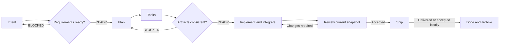

# Compass

[English](README.md) | [Tiếng Việt](README.vi.md) | **简体中文**

[](https://skills.sh/ltphat2204/compass)

**明确意图。分工执行。验证成果。**

Compass 是一个规范驱动开发（Spec-Driven Development，SDD）工作流，由九个 Agent Skills 组成，适用于 Codex、Claude Code、Cursor 和 GitHub Copilot：明确目标、制定计划、在指定范围内实施，并验证结果。工作流在不同语言、框架和交付环境中保持同一方向，技术选择以仓库中的证据为依据。

技能使用 `comp-` 前缀。通过 `$comp-engineer` 启动完整工作流，也可以调用单个技能，从已有工作文档继续。

## 理念

**目标指引方向，证据决定下一步。** Compass 保持职责和质量关卡一致，执行方式则适应任务规模、风险和实际可用的工具。

1. **先明确意图，再实施。** 定义问题、范围、约束和可观察的成功标准。先检查仓库；无法从现有信息推断重要决策时再提问。
2. **先收集证据，再选择方案。** 使用已有架构、约定、工具链和 CI。任务不需要时，不强加技术栈、架构层或依赖。
3. **用最小改动完整解决任务。** 复用已有模式。根据行为和数据受到的影响设置保障措施，而非根据 diff 行数。
4. **分工执行，责任明确。** 协调者分配工作、整合改动并决定 DONE。实施者在分配的范围内自主工作；审查者独立检查。
5. **验证必须证明结果。** 每项标准都应有检查和实际证据。执行者的报告、缺失的工具或跳过的检查，不能自动算作通过。
6. **变更后仍可追溯。** 保留 intent → plan → task → evidence → delivery 的关联；继续任务或重新规划时，保留稳定 ID、决策、备注和历史。
7. **自主行动以授权为界。** 在已分配的范围内持续推进安全的工作。合并、部署、破坏性数据变更以及对外部产生后果的操作，遵循已有授权和项目规则。

## 工作流与技能



`comp-engineer` 协调六个阶段：`Intent → Plan → Tasks → Implement → Ship → Done`。Analyze 和 Review 是交接时的质量关卡，可以单独运行，无须启动实施或交付。

| 技能 | 使用时机 | 主要结果 |
|---|---|---|
| [comp-engineer](.agents/skills/comp-engineer/SKILL.md) | 完整生命周期，或从已有工作文档继续 | 协调阶段、关卡与交接 |
| [comp-intent](.agents/skills/comp-intent/SKILL.md) | 想法不明确，或需求需要仓库证据支持 | `intent.md`、标准与决策 |
| [comp-plan](.agents/skills/comp-plan/SKILL.md) | 意图已足够明确，可以选择实施方案 | `plan.md`、验证/审查关卡与任务交接 |
| [comp-tasks](.agents/skills/comp-tasks/SKILL.md) | 拆分工作，或在保留进度的同时更新覆盖范围 | `tasks.md`、依赖与写入归属 |
| [comp-analyze](.agents/skills/comp-analyze/SKILL.md) | 检查需求或一致性 | 只读报告、READY/BLOCKED 与发现的问题 |
| [comp-implement](.agents/skills/comp-implement/SKILL.md) | 任务已就绪，可直接执行或交给子代理 | 已验证的改动、进度与实施记录 |
| [comp-review](.agents/skills/comp-review/SKILL.md) | 审查合规性和改动质量 | 针对快照的审查、问题与关卡状态 |
| [comp-ship](.agents/skills/comp-ship/SKILL.md) | 检查并交接已完成的工作 | 交付证据，以及适用时的审查/CI |
| [comp-done](.agents/skills/comp-done/SKILL.md) | 交付已确认，或本地完成已被接受 | 归档工作文档，不覆盖历史 |

## 通过 skills.sh 安装

在**目标项目**中选择代理，安装全部九个技能，以保留技能之间的引用：

```sh
npx skills add ltphat2204/compass --skill '*' --agent claude-code --copy
```

将 `claude-code` 替换为 `codex`、`cursor`、`github-copilot` 或 CLI 支持的其他代理。默认安装范围是项目；如果只希望 Compass 用于当前项目，请勿添加 `--global`。skills CLI 只安装技能和资源；Claude 原生角色需要使用下文的插件方式。

只查看列表，不安装：

```sh
npx skills add ltphat2204/compass --list
```

GitHub 仓库是分发来源。skills.sh 通过带遥测的安装记录发现技能，无须另外上传软件包。技能出现在目录中的时间取决于索引系统。[skills CLI](https://github.com/vercel-labs/skills)、[skills.sh FAQ](https://www.skills.sh/docs/faq)。

## 安装与代理集成

唯一源目录是 `.agents/skills/`；各宿主使用同一套指令和资源。Claude Code 另有[插件清单](.claude-plugin/plugin.json)，以及 [agents/](agents/comp-implementer.md) 中的两个原生角色。扩展宿主支持不会改变工作流的生命周期或权限。

### 准备仓库副本

使用现有副本，或克隆公开仓库：

```sh
git clone https://github.com/ltphat2204/compass.git
cd compass
```

### Claude Code：为当前会话加载插件

从需要工作的项目目录运行，并提供 Compass 仓库副本的绝对路径：

```sh
claude --plugin-dir /absolute/path/to/compass
```

在该会话中：

```text
/compass:comp-engineer 明确意图，制定 plan/tasks，实施并验证。
允许限定范围的实施者和独立审查者；在本地交接。
```

Claude 可以为对应的任务包使用 `compass:comp-implementer` 和 `compass:comp-reviewer`。审查者只有 Read/Glob/Grep；协调者执行检查并提供审查证据。这些角色不能自行获得 commit/push/deploy 权限，也不能超出写入范围。通过参数加载只作用于当前会话，不会全局安装或注册插件市场。[Claude 插件加载](https://code.claude.com/docs/en/plugins/create)、[子代理工具](https://code.claude.com/docs/en/sub-agents)。

清单直接指向唯一技能源目录，无须维护另一套指令副本。默认的 `agents/` 布局供 Claude 发现原生角色。[清单路径](https://code.claude.com/docs/en/plugins-reference)。

### 将技能安装到指定项目

在 Compass 仓库副本中，使用 Python 3.9+，选择宿主和已经存在的目标项目：

```sh
python3 scripts/install.py --agent codex --project /absolute/path/to/project
python3 scripts/install.py --agent claude --project /absolute/path/to/project
python3 scripts/install.py --agent cursor --project /absolute/path/to/project
python3 scripts/install.py --agent copilot --project /absolute/path/to/project
```

按宿主选择其中一行。脚本复制全部九个技能及资源，写入前检查名称冲突，拒绝重定向到项目之外的目标；若复制失败，会清理本次刚创建的技能。脚本必须指定 `--project`，没有全局模式，也不修改宿主配置。如果已有同名技能，应先比较或备份自定义内容，再自行替换；没有 `--force` 选项。

| 宿主 | 安装器创建的项目路径 | 调用工作流 |
|---|---|---|
| Codex | `.agents/skills/` | 技能选择器；CLI/IDE：`$comp-engineer` |
| Claude Code，复制技能 | `.claude/skills/` | `/comp-engineer` |
| Claude Code，插件会话 | 无须复制；使用 `--plugin-dir` | `/compass:comp-engineer` |
| Cursor | `.cursor/skills/` | `/comp-engineer`，或通过 `@` 选择技能 |
| GitHub Copilot | `.github/skills/` | 请求使用 `comp-engineer`；CLI：`/comp-engineer` |

Codex 使用项目中的 `.agents/skills`。Cursor 也会发现 `.agents/skills`；Copilot 在其文档说明的使用环境中支持该目录。直接在 Compass 仓库副本中工作时，这些宿主可以使用唯一源目录，无须复制。请检查当前宿主中的技能选择器。[Codex 技能发现](https://learn.chatgpt.com/docs/build-skills)、[Cursor 技能](https://prod.cursor.com/help/customization/skills)、[Copilot 技能](https://docs.github.com/en/copilot/concepts/agents/about-agent-skills)、[Copilot CLI 调用](https://docs.github.com/en/copilot/reference/copilot-cli-reference/cli-command-reference)。

脚本只复制技能，不复制 Claude 原生角色。需要这两个角色时，使用插件会话。避免在同一会话中既加载插件又复制同一套技能，以保持调用方式明确。

### SkCC 与 skill-sync（可选）

保持 `.agents/skills/` 为唯一源目录。[SkCC](https://github.com/Nexa-Language/Skill-Compiler) 是面向 Claude/Codex/Gemini/Kimi 的编译器；仅在宿主需要独立输出时使用。它包含优化和约束注入步骤，因此替换 Compass 指令之前，必须审查输出的语义、技能间链接和资源。编译成功本身不能证明工作流行为等价。

有多个项目叫作 `skill-sync`。[joeharris76/skill-sync](https://github.com/joeharris76/skill-sync) 适合按项目分发：选择本地 Git 技能目录、技能和版本，应用前先预览，再审查 diff 并验证已提交的内容。同步全部九个关联技能包，固定具体 commit，只声明所选项目的目标路径。源仓库必须有包含技能的提交；Git archive 不会分发尚未提交的文件。

[示例配置](integrations/skill-sync.conf.example) 专用于 `joeharris76/skill-sync`，固定了已验证的源版本。在 Compass 仓库副本中先预览，再应用：

```sh
skill-sync preview -C . -f integrations/skill-sync.conf.example
```

用于其他项目时，将 `source` 改为 Compass 仓库副本的路径，并确认三个目标路径适合该项目。该配置尚未通过上游工具执行；它不会自动启用同步或替换现有配置。

一些同名工具主要面向用户级目录，或在同步网络中按 version/mtime 选择优先版本。它们不是 Compass 的默认方案。上述两个工具尚未在本项目中安装或运行；本地安装器和 skills CLI 仍是已验证的分发方式。不要仅为启用可选集成而增加依赖或全局监听器。

### 其他代理

支持 Agent Skills 的代理，可以将 `.agents/skills/` 中全部九个目录放入其文档规定的技能发现路径。如果没有发现机制，可要求代理从仓库副本读取 `comp-engineer/SKILL.md`，再按需加载相关技能和参考资料。这是手动使用指令的方式，并不表示该宿主上的原生插件已经测试。

各宿主使用自己的 API/工具、仓库指令和权限模型。不要假设 Codex 工具名、`$` 语法、子代理 API 或工作区隔离机制完全相同。无法委派时，直接或串行执行；缺少必须的审查者时，关卡仍保持 PENDING。映射说明见[宿主集成](.agents/skills/comp-engineer/references/hosts.md)。

### 更新与限制

更新仍使用旧前缀的提示词或快捷方式；已有 `dev/` 工作文档、任务 ID 和历史继续保留。插件会话读取唯一源目录；在 Claude 中修改插件后，使用 `/reload-plugins`。复制的技能应在比较自定义内容后主动升级，不会在项目间自动同步。[Claude 重新加载](https://code.claude.com/docs/en/plugins/create)。

Compass 不要求 MCP server、hooks 或新的应用运行时。Python 仅用于安装器和检查；RTK、CodeGraph、Ponytail、子代理以及审查/CI 工具，按宿主和仓库情况选用。不要仅为运行工作流而启用实验性 agent teams 或放宽权限。

## 使用方法

以下 `$comp-*` 示例使用 Codex 语法。Claude 插件使用 `/compass:comp-*`；复制到 Claude 的技能或 Cursor 使用 `/comp-*`。其他宿主使用技能选择器，或要求代理读取对应技能。

### 分配完整工作流

```text
$comp-engineer 为这个 CLI 添加数据导出功能。根据仓库明确意图，
按风险选择模式，制定 plan/tasks，然后实施并验证。
允许限定范围的子代理和独立审查者；完成后在本地交接。
```

协调者收集实际上下文，询问尚未确定的决策，并根据工作文档选择下一步。Ship 可以是本地交接；该提示词不授予部署或远程合并权限。

### 调用单个阶段或继续任务

```text
$comp-intent 明确 CLI 重试需求；将意图写入 dev/cli-retry/。
$comp-plan 根据 dev/cli-retry/intent.md 在同一目录中制定计划。
$comp-tasks 根据 dev/cli-retry/ 的 intent/plan 更新任务；保留 ID 和进度。
$comp-analyze 在实施前检查 dev/cli-retry/ 的一致性；只报告。
$comp-implement 执行 dev/cli-retry/ 中已就绪的任务。
$comp-review 根据 dev/cli-retry/ 审查当前快照的改动；只报告。
$comp-ship 使用已有证据，检查并在本地交接 dev/cli-retry/。
```

交付已确认，或本地完成已被接受后，再调用 `$comp-done`。选择与请求相符的阶段；审查请求不会自动启动整个生命周期。

## 使用场景

| 场景 | 使用方式 | 预期结果 |
|---|---|---|
| 涉及多个组件的功能 | `comp-engineer`，standard；授权使用子代理 | 按依赖组织任务，明确归属，整体验证和独立审查 |
| 有明确复现步骤的小 bug | `comp-engineer`，light；已有任务时也可用 `comp-implement` | 小范围改动，验证复现步骤和受影响范围 |
| 尚不明确的想法 | `comp-intent`、`comp-analyze` requirements | 可观察的标准；规划前明确重要决策 |
| 可行性评估 | `comp-engineer`，限时 spike | intent 中记录学习计划/清单，提供证据和 stop/go；不默认产出生产代码 |
| 库或 CLI 重构 | Plan → Tasks → Implement → Review | 保持契约，检查调用方，通过已有工具链验证前后行为 |
| 安全或数据变更 | Standard，按影响设置关卡 | 失败/恢复证据、任务审查和策略要求的审查者；缺少审查时保持 PENDING |
| 只审查代码或工作文档 | `comp-review` 或 `comp-analyze` | 有依据的发现，只读；不修改任务记录或交付 |
| 范围变更后继续任务 | 对已有工作文档使用 `comp-plan`、`comp-tasks` | 保留仍有效的 DONE 工作；重新打开受影响工作及依赖检查，保留历史 |
| 文档，或没有 CI/远程仓库的项目 | 按规模选择模式、适当检查、本地交接 | 内容/链接验证或手动证据；不额外搭建技术栈 |

Spike 示例：

```text
$comp-engineer 用 30 分钟的 spike 评估解析器能否处理目标输入。
只提供证据和 stop/go 建议；
说明测量限制，不进行生产实施。
```

## 工作文档与模式

默认目录为 `dev/{feature-slug}/`；已有目录或用户选择的根目录会在整个工作流中保留。

```text
dev/{feature-slug}/
├── intent.md       # Problem, scope, criteria, project context, decisions
├── plan.md         # Approach, dependencies, verification, review gates
├── tasks.md        # Stable IDs, owners, write scope, status, progress
└── walkthrough.md  # Actual changes, attempts, checks, review, limitations
```

| 模式 | 工作文档 | 适用情况 |
|---|---|---|
| Standard | Intent、包含五个实质内容部分的 plan、tasks、walkthrough | 较大或有风险的工作 |
| Light | 精简的 intent/plan/tasks/walkthrough；合并适当部分，省略空阶段 | 范围明确的改动，保留相同的必需关卡 |
| Spike | Intent 包含学习计划/清单；walkthrough 记录结果 | 有边界的学习；生产实施前需要定义新范围 |

模式调整文档量；风险决定验证方式和审查者。小 diff 也可能有高风险。`comp-done` 归档到 `_archived/YYYYMMDD/{feature-slug}/`，避免覆盖已有工作。

## 子代理与审查者

协调者负责分配、整合、`tasks.md`、`walkthrough.md`、进度和 DONE 决策。Standard 工作在工具可用且已获授权时使用限定范围的实施者；紧密耦合或不值得拆分的工作直接或串行执行。

执行者收到最小任务包：标准、基线、必读上下文、写入范围、依赖、交付物、验证命令和报告阻塞的条件。执行者返回实际 diff 和结果；不得自行修改共享工作文档、重新启动生命周期，或在授权任务之外 commit/push。

只有依赖就绪、契约稳定、写入范围和资源相互独立的任务才可并行，包括测试、配置和生成文件。每个文件或资源只能有一个活跃写入者。执行者数量遵循环境的并发上限，并计入协调者。

协调者核对实际改动，并运行整体集成检查。安全、数据、公共契约或前置任务，在标记 DONE 或解除依赖阻塞之前必须审查；其他任务可按里程碑审查。

Ship 前，在可用且已获授权时，使用具有全新上下文的独立审查者。审查者针对稳定快照检查合规性和改动质量。输入发生变化时，相关批准失效。只有风险和策略允许时才能退回自审；子代理不能替代明确要求的人工审查者。参见[委派协议](.agents/skills/comp-implement/references/delegation.md)。

## 质量关卡与冲突

- **Plan 前：** 需求明确，结果可观察，范围/失败预期和假设清楚。
- **Implement 前：** criteria → plan → tasks → verification 有覆盖关系；范围、约束和依赖一致。
- **Ship 前：** 证据仍有效，合规性/改动质量已审查，必需关卡已通过。

独立的分析、审查和就绪检查均为只读。执行已分配阶段时，协调者在工作文档中记录范围、发现和关卡状态。BLOCKER、缺少证据或缺少必需审查者，会阻止对应阶段，不能记为通过。低风险允许明确标注的自审；中风险需要调用方/集成检查和策略要求的审查者；高风险需要独立或人工审查。

已确认的意图定义结果；项目必需指令或章程约束方案；计划和任务落实意图；现有代码提供证据。重要冲突需要有权限的负责人作出决策，并记录理由和限定范围的例外，不能暗中丢弃规则。平台指令和授权仍具有更高优先级。

## 技能验证

[评估案例](evals/cases.md) 描述八个行为场景和两个集成/分发案例：模糊需求、工作文档冲突、高风险审查、仓库规则冲突、保留历史的重新规划、有边界的 spike、委派实施、工具/审查者不可用时的回退、宿主打包/项目隔离，以及公开 skills.sh 分发。[评估结果](evals/results.md) 记录实际结果、修正和验证限制。

验证器检查打包和 frontmatter；行为评估检查决策、改动和证据。C7 在一个小型 Python 测试项目上使用了三个实施者和一个独立审查者；这不能证明任意仓库上的正确性，也不能证明并行执行不存在竞争问题。技能改名不意味着已重新运行行为案例。

本地集成检查：

```sh
claude plugin validate --strict .
claude plugin validate --strict agents
claude --plugin-dir . plugin details compass
PYTHONDONTWRITEBYTECODE=1 python3 -m unittest discover -s evals -p 'test_*.py' -v
```

Claude CLI 检查不会调用模型。请查看[集成结果](evals/results.md)，区分已检查的清单/技能发现行为与尚未运行的宿主行为执行。
